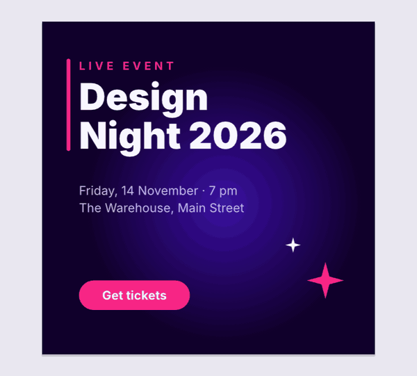
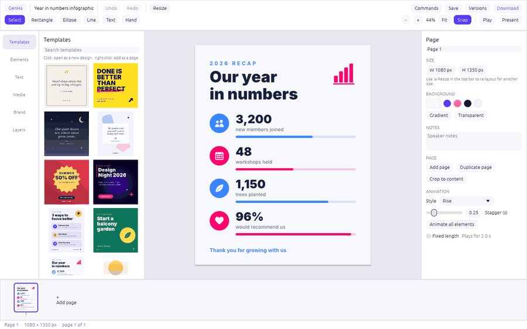
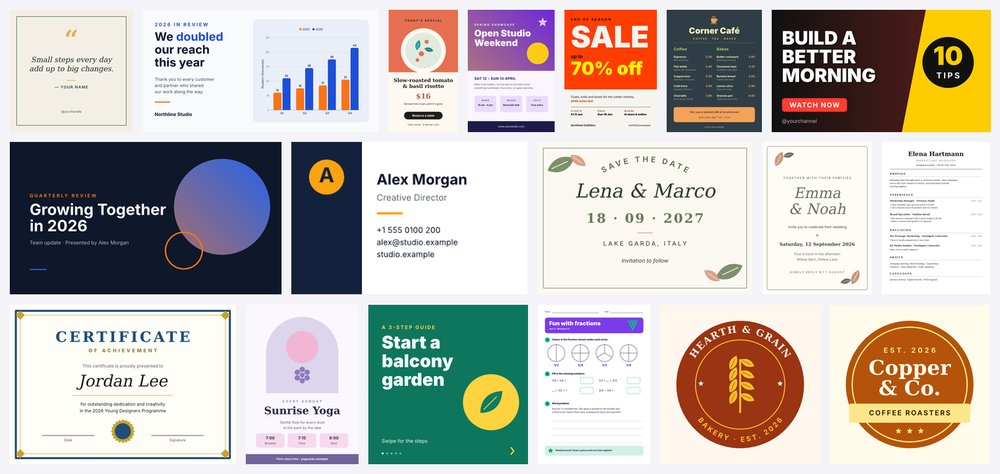
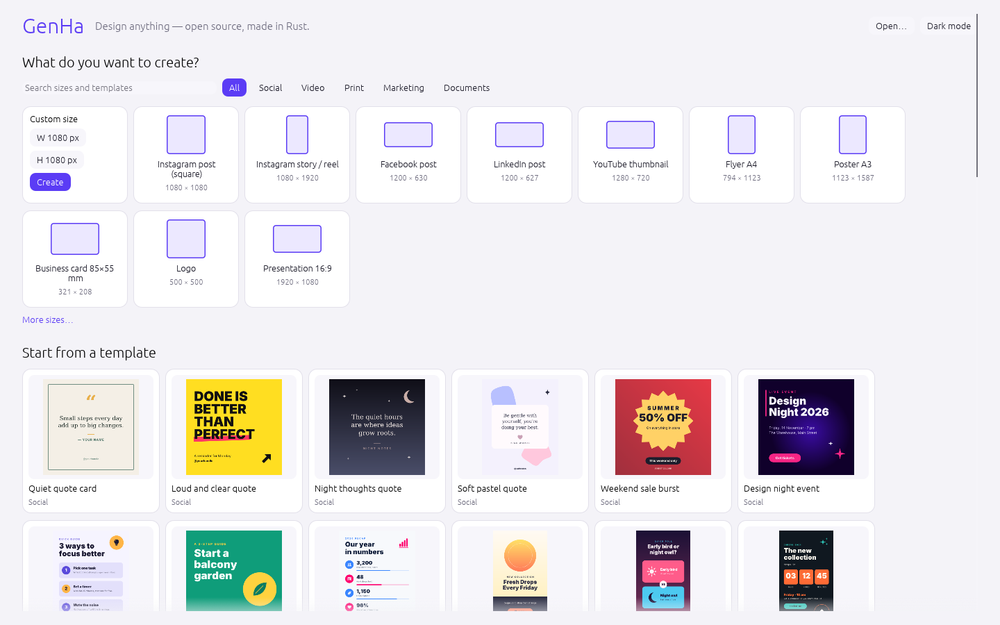
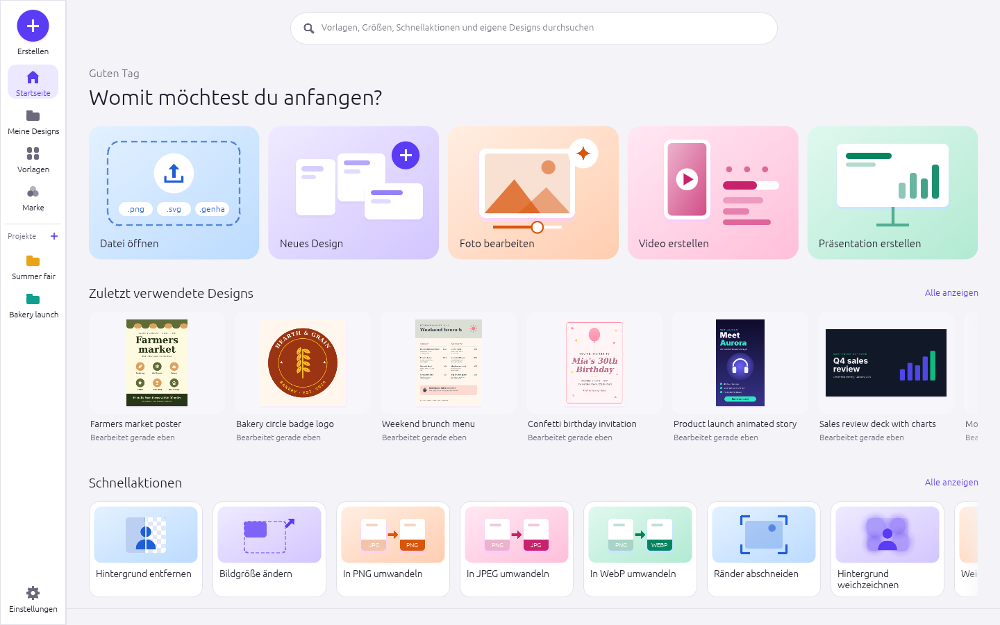

# GenHa

**Design anything — open source, made in Rust.**

[](https://github.com/DJTobi24/genexpress/actions/workflows/ci.yml)


GenHa is a free, open-source design app for quick content: social posts and stories, flyers,
posters, logos, business cards, presentations, resumes, invitations and short animated videos.
It aims at the feature set of Adobe Express — and beyond — as an **independent, clean-room
project**: its own name, its own UI, its own templates and artwork, 100% Rust, no account, and
everything runs on your own computer (desktop on Windows, macOS and Linux, or in the browser).


## See it in action

| Edit text right on the canvas | Smart resize to any format |
|---|---|
|  |  |
| Type into the design, format single words (font, size, bold, colour), undo it all in one step. | One design becomes a story, a banner or a slide: text reflows, rows and grids re-arrange. |

| Animate and present | 121 original templates |
|---|---|
|  |  |
| Entrance, loop and exit animations, played on the canvas, in present mode (F5), or exported as MP4 or GIF. | Posts, stories, flyers, menus, cards, invitations, invoices, resumes, decks, worksheets and logos — every one made for GenHa, in code. |

## What it can do

- **Start fast:** a home screen with one search over templates, sizes, quick actions and your designs; start tiles to open a file, pick a size (35 presets or a custom size), edit a photo, make a video or a presentation; 121 templates in 6 categories.
- **Edit:** multi-page designs (pages of any size); move, resize and rotate with smart guides (snapping, equal spacing, distance hints); groups, layers, lock/hide, align & distribute; copy/paste of objects and styles; undo/redo; version history; Data Recovery after a crash; My designs with project folders and recent designs.
- **Text:** edited in place on the canvas, with real typography (kerning, ligatures, Arabic, Hebrew, Indic scripts, font fallback for mixed text); format single words; 25 text styles; shadow, outline and highlight effects; curved text.
- **Content:** charts (bar, line, area, pie, donut, progress — several series, stacked, axis titles), tables with merged and styled cells, shapes and 114 original icons, QR codes, collages, 40 palettes, brand kits.
- **Pictures:** crop, fit, crop to shape, corners, borders, adjustments, 14 filters; **remove, blur or change the background** — with an AI model that finds the subject on busy photos (U²-Net, Apache-2.0, downloaded once on request, runs locally) or a fast colour-based method.
- **Smart resize:** re-lay out a design for another format, or add a resized copy.
- **Motion:** animations for any object or text, "animate all" with a stagger, playback on the canvas, present mode.
- **Export:** PNG (also transparent, 2×), JPEG, SVG, **vector PDF** with real, searchable text, **print PDF** (300 dpi, bleed, crop marks, optional CMYK), **MP4 video** (our own pure-Rust H.264 encoder), animated GIF and PNG. Native `.genha` files.
- **Quick actions** (file in, file out): remove / blur / change background, resize, convert, trim, black & white, pixelate; a QR code or a photo collage in one step.
- **Languages:** English and German, switched live; text in any script shows correctly.
- **Automation:** every action is one of 181 commands, reachable from the UI, the command line, a JSON control channel and an **MCP server for AI assistants** — anything a user can do, an agent can do.

| Home screen | Auf Deutsch |
|---|---|
|  |  |

## Run it

You need a recent stable Rust toolchain ([rustup.rs](https://rustup.rs)).

```sh
cargo run --release -p genha                                  # the desktop app
cargo run --release -p genha-cli -- --help                    # the command line
cargo xtask web && python3 -m http.server -d dist/web 8080    # the web app, then open http://127.0.0.1:8080
```

On Linux the desktop app needs the usual GUI libraries (e.g. `libxkbcommon-dev libgtk-3-dev` on
Debian/Ubuntu). The web version is the same app compiled to WebAssembly: files open through the
browser's file picker or by dropping them on the page, and Save / Download become browser
downloads ([docs/development.md › Web](docs/development.md#web)).

### Command line

```sh
genha-cli templates                                           # list templates (also: presets)
genha-cli new --template event-night -o party.genha
genha-cli export party.genha -o party.pdf                     # png, jpg, svg, pdf, gif, mp4
genha-cli export party.genha -o party.mp4 --quality high      # every page, each for its duration
genha-cli model download                                      # the background removal model (4.6 MB, once)
genha-cli quick remove-background photo.jpg -o cutout.png     # AI model when downloaded, else colour-based
genha-cli run script.json --export out.png                    # script: [{"command": "...", "params": {...}}]
```

### For AI agents

- `genha-cli mcp` starts an MCP server (headless), `genha-cli mcp --attach 127.0.0.1:7979` drives a
  running app — see [docs/mcp.md](docs/mcp.md).
- `genha --control 7979` opens a JSON-lines control channel on localhost — see
  [docs/control-protocol.md](docs/control-protocol.md).
- `genha-cli commands` lists every command with its parameters.

## Status

**Pre-alpha.** It is usable for real designs, but file formats and commands may still change.
By our own (deliberately low) estimate GenHa covers about 30–35% of the target feature set; the
biggest gaps are collaboration and sharing, a stock content library, generative AI features, a
video timeline with audio, and more UI languages.

| | |
|---|---|
| Templates / size presets / icons / palettes | 121 / 35 / 114 / 40 |
| Commands (UI = CLI = MCP) | 181 |
| Tests | 380 |
| Code | ~57k lines of Rust |

- [ROADMAP.md](ROADMAP.md) — stage, numbers, what's next and the progress log.
- [docs/target-app-parity.md](docs/target-app-parity.md) — feature-by-feature comparison with the target app.
- [docs/gaps.md](docs/gaps.md) — every known shortfall, ranked.

## Contributing

- [AGENTS.md](AGENTS.md) — the rules: clean-room, never crash, everything is a command, quality gates.
- [docs/architecture.md](docs/architecture.md) — crates and layers; [docs/development.md](docs/development.md) — building, testing, translating.
- `cargo xtask ci` (format, clippy, tests, layers, assets, clean-room and WebAssembly checks) must pass before every commit.

GenHa follows the conventions of the ArtCraft apps (VectorCraft, PhotoCraft, PDFCraft): a layered
Cargo workspace, "everything is a command", a never-crash policy and first-class automation.

## Licence

Code and original assets: MIT OR Apache-2.0 (see `LICENSE-MIT`, `LICENSE-APACHE`, `NOTICE`).
The optional background-removal models are downloaded on request and are Apache-2.0
([ASSETS.md](ASSETS.md)). H.264 is covered by patents in some countries; see `NOTICE`.
GenHa is not affiliated with Adobe Inc.; "Adobe Express" is their trademark, named only to
describe the feature set this project covers.
