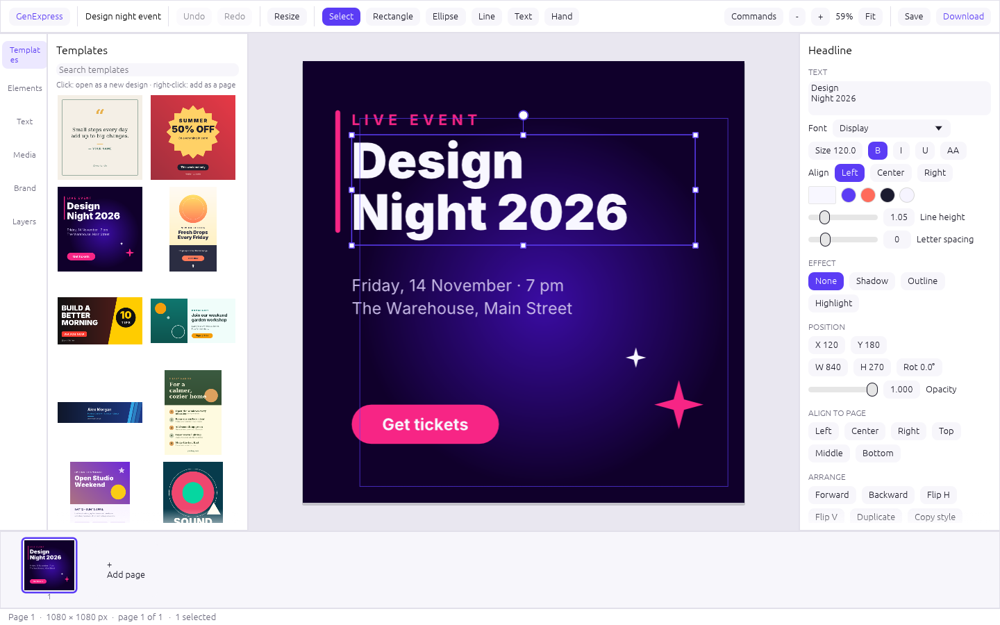

# GenHa

**Design anything — open source, made in Rust.**

GenHa is a free, open-source design app for quick content: social posts and stories, flyers,
posters, logos, business cards, presentations, resumes and invitations. It aims at the feature set
of Adobe Express — and beyond — as an **independent, clean-room project**: its own name, its own UI,
its own templates and artwork, 100% Rust, MIT OR Apache-2.0, no account, everything runs locally.

It follows the conventions of the ArtCraft apps (VectorCraft, PhotoCraft, PDFCraft): a layered Cargo
workspace, "everything is a command", a never-crash policy, and first-class automation for AI agents
(control channel, CLI and an MCP server).



## Status

**Stage: pre-alpha (M1 done).** A working desktop editor with templates, smart resize, picture tools
and exports; ~20–25% of the target feature set by our own (low) estimate — see
[ROADMAP.md](ROADMAP.md) and [docs/target-app-parity.md](docs/target-app-parity.md).

What works today:

- **Start**: 35 size presets (social, video, print, marketing, documents) or a custom size; 17 original templates; open pictures as a design.
- **Edit**: multi-page designs (pages of different sizes), select/move/resize/rotate with smart snapping, groups, layer order, lock/hide, align & distribute, copy/paste (also style), undo/redo.
- **Content**: text with styles, presets and effects (shadow, outline, highlight); shapes and 25 original icons; QR codes; collages; brand kit (colours, fonts, palettes, colours from a photo).
- **Pictures**: place, crop, fit, crop to shape, corner radius, border, adjustments, 14 filters, background removal (colour-based).
- **Smart resize**: re-lay out a page for another size, or add a resized copy.
- **Export**: PNG (also transparent and 2×), JPEG, SVG, multi-page PDF. Native `.genha` files.
- **Quick actions** (file in, file out): remove background, resize, convert PNG/JPEG/WebP, trim, black & white.
- **Automation**: 102 commands reachable from the UI, the CLI, a JSON-lines control channel and MCP.

## Run it

```sh
cargo run --release -p genha                       # the desktop app
cargo run --release -p genha-cli -- --help         # the command line
```

Command-line examples:

```sh
genha-cli templates
genha-cli new --template event-night -o party.genha
genha-cli export party.genha -o party.pdf
genha-cli quick remove-background photo.jpg -o cutout.png
genha-cli run script.json --export out.png         # script: [{"command": "...", "params": {...}}]
genha-cli mcp                                      # MCP server for AI assistants
```

## For contributors and agents

- [AGENTS.md](AGENTS.md) — the rules (clean-room, never crash, everything is a command, quality gates).
- [docs/architecture.md](docs/architecture.md) — crates and layers.
- [docs/gaps.md](docs/gaps.md) — the ranked work list.
- `cargo xtask ci` must pass before every commit.

## Licence

Code and original assets: MIT OR Apache-2.0 (see `LICENSE-MIT`, `LICENSE-APACHE`, `NOTICE`).
GenHa is not affiliated with Adobe Inc.; "Adobe Express" is their trademark, named only to
describe the feature set this project covers.
